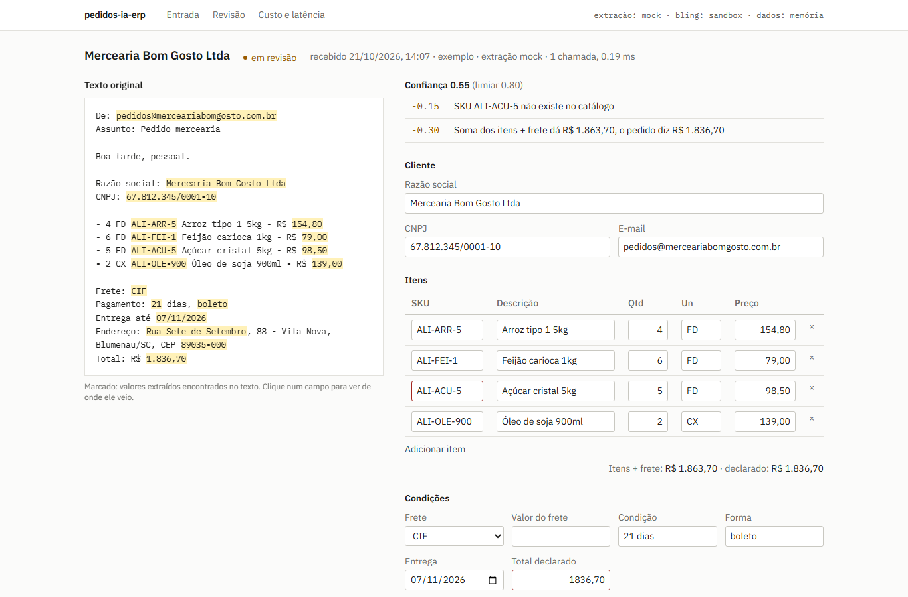

# pedidos-ia-erp

Lê pedidos de compra que chegam por e-mail ou PDF, extrai os dados com um LLM validado por schema, manda para revisão humana quando a confiança é baixa e lança o pedido no ERP Bling pela API v3. Cada chamada ao modelo fica registrada com tokens, custo estimado e latência.

Demo: https://pedidos-ia-erp.vercel.app (extração em modo mock, Bling em sandbox, dados em memória)



## O problema

Distribuidor B2B recebe pedido em formato livre: lista no corpo do e-mail, tabela colada da planilha, PDF do sistema do cliente, mensagem de uma linha. Alguém redigita tudo no ERP. O erro caro não é a digitação lenta, é o pedido lançado com o CNPJ errado, um SKU que não existe ou um total que não fecha. A extração por LLM resolve a redigitação; o resto do projeto existe para pegar esses erros antes de chegarem ao ERP.

## Como funciona

```
 e-mail (texto)   PDF (unpdf)   exemplos
        \             |            /
         v            v           v
   POST /api/extract   POST /api/pdf
                 |
                 v
   extrair(texto)  -- provedor plugável ------------------------------+
     anthropic: Claude com tool use, input_schema gerado do zod        |
     mock:      regex/heurística, determinístico, sem custo            |
     edge:      Supabase Edge Function (Deno), mesmo laço              |
                 |                                                     |
                 v                                                     |
   PedidoSchema.safeParse --falhou--> erros voltam ao modelo como      |
                 |                    tool_result is_error (1 retry) --+
                 v
   calcularConfianca: 1,0 menos penalidades com motivo
     CNPJ sem dígito verificador válido, SKU fora do catálogo,
     soma dos itens + frete != total escrito, campo ausente, preço
     muito longe da tabela, precisou de retry
                 |
       >= limiar |  < limiar
                 |      \
                 |       v
                 |   fila de revisão: texto original lado a lado,
                 |   valores marcados, correção, aprovação humana
                 v      /
   chave de idempotência = sha256(CNPJ, itens, qtd, preço, frete, entrega)
   reserva a chave (PK no Postgres) -> Bling POST /pedidos/vendas
                 |
                 v
   Repositorio (memória | Supabase): pedidos, chamadas_modelo,
   lancamentos_bling, bling_tokens
```

Arquivos principais:

| Caminho | O que faz |
| --- | --- |
| `src/lib/schema.ts` | Schema zod do pedido; também gera o JSON Schema da ferramenta |
| `src/lib/extract/` | Laço de validação e retry, provedores Anthropic, mock e Edge, tabela de preços |
| `src/lib/confidence.ts` | Nota de confiança com motivo e penalidade de cada problema |
| `src/lib/cnpj.ts` | Validação do CNPJ pelos dígitos verificadores |
| `src/lib/bling/` | Cliente OAuth2 da API v3, mapeamento para o payload, modo sandbox |
| `src/lib/idempotency.ts` | Chave do lançamento |
| `src/lib/pipeline.ts` | Fluxo: receber, corrigir, aprovar, lançar |
| `src/lib/repo/` | Interface do repositório e implementações em memória e Supabase |
| `supabase/migrations/` | Tabelas, índices, RLS e uma view de custo diário |
| `supabase/functions/extract/` | Edge Function em Deno; importa schema, prompt e preços de `src/lib` |

## Decisões

- **Tool use não estrito, validação no zod.** O schema tem padrões (CNPJ, CEP, data ISO) que o modo estrito não cobre. O modelo chama `registrar_pedido`, o zod valida, e se falhar a lista de erros volta como `tool_result` com `is_error: true`. Uma nova tentativa só: se errar duas vezes, o pedido vai para revisão com o erro visível em vez de gastar mais chamadas.
- **Confiança calculada, não perguntada ao modelo.** Pedir ao LLM um número de 0 a 1 dá um valor que ninguém consegue auditar. Aqui cada desconto tem um motivo que a pessoa da revisão lê ("soma dá R$ 1.863,70, o pedido diz R$ 1.836,70"). Penalidades por item têm teto para pedido longo não zerar só por ser longo.
- **O prompt manda deixar null o que não está no texto.** O sistema confere SKU e CNPJ depois; um valor inventado esconderia o problema. A tela de revisão ainda marca campo preenchido cujo valor não aparece no texto original.
- **Idempotência por conteúdo, reservada antes de chamar o Bling.** O mesmo e-mail encaminhado duas vezes gera a mesma chave. A chave é gravada antes da chamada externa (primary key no Postgres, então duas requisições simultâneas não passam) e é liberada se o Bling falhar, para permitir nova tentativa.
- **Refresh token do Bling em tabela, não em variável de ambiente.** O Bling troca o refresh token a cada renovação; guardado só em env, a próxima instância usaria um token já invalidado.
- **Custo pelo modelo que respondeu.** O preço usa `response.model`, porque com fallback do servidor a resposta pode vir de outro modelo. Tokens de cache entram com o multiplicador certo.
- **Repository pattern.** A demo na Vercel usa memória; com `STORAGE=supabase` a mesma interface grava no Postgres. Os testes rodam contra a implementação em memória.

## Limitações

- Na demo o Bling está em modo sandbox: o payload de `POST /pedidos/vendas` é montado e mostrado, mas não é enviado. O cliente real (OAuth2, renovação de token, 401 com nova tentativa, busca ou criação do contato pelo CNPJ) está implementado e testado com `fetch` falso, não contra uma conta Bling.
- A demo usa o provedor mock. Ele entende os formatos dos exemplos e variações próximas; texto muito diferente sai incompleto e cai na revisão, que é o comportamento esperado, mas não representa a qualidade do modelo. Os tokens do mock são estimados pelo tamanho do texto e o custo mostrado é o que a chamada custaria no modelo padrão.
- Os dados da demo ficam na memória da função serverless. Uma instância nova recomeça com os exemplos; um pedido criado em uma instância pode não existir em outra.
- PDF escaneado (imagem) não tem texto selecionável e é recusado; não há OCR.
- O catálogo de SKUs é estático. Em produção viria de `GET /produtos` do Bling.
- A Edge Function passou no `deno check`, mas não foi publicada num projeto Supabase.
- Não há autenticação nas telas.

## Como rodar

Requer Node 20 ou mais novo.

```bash
npm install
cp .env.example .env.local
npm run dev          # http://localhost:3000
npm test             # 72 testes
```

Sem nenhuma variável o app sobe com extração mock, Bling sandbox e dados em memória, já com os seis exemplos processados.

### Com o Claude

```bash
EXTRACT_PROVIDER=anthropic
ANTHROPIC_API_KEY=sk-ant-...
ANTHROPIC_MODEL=claude-opus-5-5   # opcional
```

### Com Supabase

```bash
supabase link --project-ref <ref>
supabase db push                                  # aplica supabase/migrations
supabase secrets set ANTHROPIC_API_KEY=sk-ant-...
supabase functions deploy extract
```

E no `.env.local`:

```bash
STORAGE=supabase
SUPABASE_URL=https://<ref>.supabase.co
SUPABASE_SERVICE_ROLE_KEY=...
EXTRACT_PROVIDER=edge          # ou "anthropic" para extrair no próprio Next
SUPABASE_ANON_KEY=...
```

### Com o Bling de verdade

Crie um aplicativo no Bling, autorize uma vez para obter o primeiro refresh token e configure:

```bash
BLING_MODE=live
BLING_CLIENT_ID=...
BLING_CLIENT_SECRET=...
BLING_REFRESH_TOKEN=...   # usado só na primeira vez; depois vale o da tabela bling_tokens
```

### API

```bash
curl -X POST localhost:3000/api/extract -H "Content-Type: application/json" -d '{"exemplo":"mercearia"}'
curl -X POST localhost:3000/api/extract -H "Content-Type: application/json" -d '{"texto":"..."}'
curl -X POST localhost:3000/api/pdf -F "arquivo=@docs/exemplo-pedido.pdf"
curl localhost:3000/api/pedidos?status=revisao
curl -X PATCH localhost:3000/api/pedidos/<id> -H "Content-Type: application/json" -d '{"pedido":{...}}'
curl -X POST localhost:3000/api/pedidos/<id>/aprovar
curl localhost:3000/api/metricas
```

## Stack

Next.js 15 (App Router), TypeScript, Tailwind CSS 4, zod 4, SDK da Anthropic, unpdf, Supabase (Postgres e Edge Functions em Deno), Vitest. CI no GitHub Actions roda typecheck, lint, testes e build.
